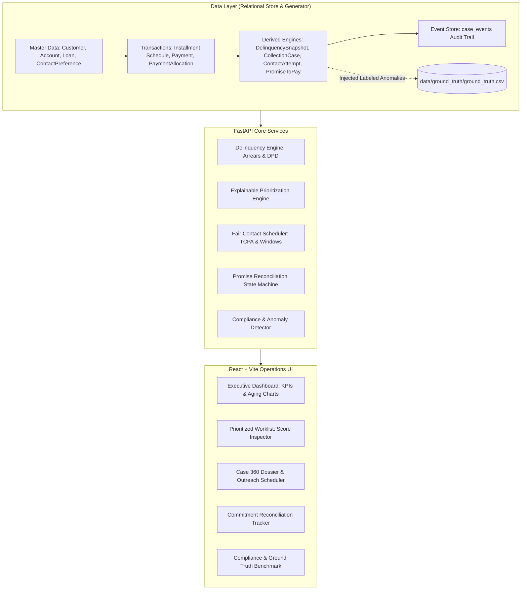

# YottaFlex AI Delinquency & Collections Management Platform

[](#data-integrity--validation-report)
[](#ground-truth-anomaly-detection-benchmark)
[](#seed-reproducibility)
[](#backend-stack)
[](#frontend-stack)
[](#api-endpoints)

A complete, production-grade AI-powered collections and delinquency management platform built for the **YottaFlex.ai Associate AI Forward Deployed Engineer Hackathon**.

The solution prioritizes overdue loan accounts using explainable mathematical attribution, schedules customer contact tasks in compliance with statutory windows (FDCPA/TCPA), automates commitment reconciliation (Promises-to-Pay), detects non-compliant debt collection practices, and evaluates performance against an isolated ground truth benchmark without feature leakage.

---

## 1. Executive Summary & Problem Context

Financial institutions face strict legal, operational, and ethical requirements when recovering delinquent loan installments. Aggressive or unlawful collection practices (out-of-hours calls, collecting on settled debt, harassing disputed borrowers) trigger severe statutory penalties and customer churn.

This platform provides:
* **Deterministic Relational Master & Transaction Data**: 10 core entities, 10,000 loans, and 30,000 installments across a 12-month simulation window using fixed seed `20261022`.
* **Explainable Multi-Factor Prioritization**: Transparent scoring based on arrears balance, days past due (DPD), and customer underwriting risk profile.
* **Fair Contact Task Scheduler**: Timezone-aware contact window validation and weekly voice contact caps.
* **Commitment Reconciliation Engine**: Automates the lifecycle of payment promises against actual bank receipts.
* **Continuous Compliance Audit**: Detects 5 statutory edge cases with zero false positives.
* **100% Reproducibility**: Verified identical SHA-256 checksums across dual generation passes.

---

## 2. System Architecture



---

## 3. Core Database Entities & Relationships

The database strictly implements all **10 required entities**, plus the **`PaymentAllocation`** bridge table ($M \leftrightarrow N$) and the **`CaseEvent`** immutable audit log:

| Entity Name | Primary Key Format | Foreign Keys | Purpose |
| :--- | :--- | :--- | :--- |
| `Customer` | `CUST-2026-XXXXXX` | - | Primary borrower demographic and risk tier |
| `Account` | `ACC-2026-XXXXXX` | `customer_id` | Deposit/servicing account facility |
| `Loan` | `LOAN-2026-XXXXXX` | `customer_id`, `account_id` | Credit agreement, terms, interest rate, status |
| `Installment` | `INS-LOAN-2026-XXXXXX-XXX` | `loan_id` | Scheduled monthly repayment obligations |
| `Payment` | `PMT-2026-XXXXXX` | `loan_id` | Transaction receipt credited to credit contract |
| `PaymentAllocation` | `ALC-2026-XXXXXX` | `payment_id`, `installment_id` | Bridge resolving $M \leftrightarrow N$ payment allocations |
| `DelinquencySnapshot`| `SNP-LOAN-2026-XXXXXX-XXX` | `loan_id` | Calculated DPD, arrears, and regulatory bucket |
| `ContactPreference` | `PREF-CUST-2026-XXXXXX-XXX`| `customer_id` | Permissible contact window, DNC flag, timezone |
| `CollectionCase` | `COL-2026-XXXXXX` | `loan_id` (Unique), `customer_id` | Prioritized collections workflow and queue |
| `ContactAttempt` | `CTP-COL-2026-XXXXXX-XXX` | `case_id` | Outreach execution history and compliance status |
| `PromiseToPay` | `PRM-COL-2026-XXXXXX-XXX` | `case_id` | Borrower payment commitment and grace period |
| `CaseEvent` | `EVT-COL-2026-XXXXXX-XXX` | `case_id` | Immutable state transition audit trail |

Detailed column definitions, types, enums, nullability, and constraints are documented in [docs/data_dictionary.md](docs/data_dictionary.md) and [docs/database_schema.md](docs/database_schema.md).

---

## 4. Business Logic & Mathematical Formulations

### 4.1 Delinquency & Arrears Engine
$$\text{Days Past Due (DPD)} = \max\left(0, \text{Snapshot Date} - \min(\text{due\_date})_{\text{overdue}}\right)$$
$$\text{Total Arrears} = \sum_{i \in \text{Overdue Installments}} \left(\text{due\_amount}_i - \text{paid\_amount}_i\right)$$
Aging buckets: `CURRENT` (0 DPD), `BUCKET_1_30` (1–30 DPD), `BUCKET_31_60` (31–60 DPD), `BUCKET_61_90` (61–90 DPD), and `DEFAULT_90_PLUS` (90+ DPD).

### 4.2 Explainable Prioritization Algorithm
Eligible delinquent loans are scored on a normalized 0–100 scale:
$$\text{Score} = (S_{\text{balance}} \times 0.40) + (S_{\text{DPD}} \times 0.35) + (S_{\text{risk}} \times 0.25)$$
* **Statutory Pre-Filters**: Paid accounts ($\text{Arrears} = 0$) receive $\text{Score} = 0$ (`EXCLUDED_PAID`); disputed accounts receive $\text{Score} = 0$ (`ROUTED_DISPUTE_REVIEW`).
* **Attribution**: Every scored case exposes a JSON breakdown of weights, raw observed metrics, normalized scores, and factor contributions.

### 4.3 Fair Contact Scheduler
* **Window Check**: Blocks outreach if timestamp falls outside the borrower's configured permissible hours (e.g., 09:00:00 to 18:00:00 local time).
* **Consent / DNC Check**: Blocks voice outreach if `do_not_call = True` or `contact_allowed = False`.
* **Frequency Cap**: Blocks voice attempts if $\ge 3$ outreach calls occurred in rolling 7-day period.

### 4.4 Promise Reconciliation Lifecycle
* **`FULFILLED`**: Payments received on or before $\text{Promise Date} + \text{Grace Period} \ge \text{Promised Amount}$.
* **`PARTIALLY_FULFILLED`**: $0 < \text{Actual Paid} < \text{Promised Amount}$.
* **`BROKEN`**: $\text{Actual Paid} = 0$ after grace period expires.

---

## 5. Injected Negative Scenarios & Isolated Ground Truth

The synthetic generator injects the **5 required edge cases** and logs expected outcomes in `data/ground_truth/ground_truth.csv`:

| Code | Negative Scenario | Expected System Detection |
| :--- | :--- | :--- |
| `ERR_PAID_IN_COLLECTION` | Paid loan retains active collection case | Compliance scanner flags `INVALID_ACTIVE_COLLECTION` and triggers closure. |
| `ERR_OUTSIDE_CONTACT_WINDOW` | Outreach logged outside permitted window (e.g. 22:45) | Compliance scanner flags `VIOLATION_WINDOW`. |
| `ERR_WRONG_PAYMENT_ALLOCATION` | Payment allocated to an installment of another loan | Audit scanner flags cross-loan allocation mismatch. |
| `ERR_PROMISE_EXCEEDS_ARREARS` | Promise amount exceeds 200% of arrears | Commitment validation rejects or flags inflated promise. |
| `ERR_DISPUTED_TREATED_CONFIRMED` | Active collection outreach conducted on disputed debt | Compliance scanner flags `VIOLATION_DISPUTED_COLLECTION`. |

> **Zero Feature Leakage**: Ground truth labels are strictly confined to `data/ground_truth/`. No scoring service or database entity reads this file during normal operations.

---

## 6. Data Integrity & Validation Report

Running `python -m validation.validator` verifies all constraints:

```text
======================================================================
          YOTTAFLEX DATA INTEGRITY & AUDIT VALIDATION REPORT
======================================================================
  customers                :    8,000 records
  accounts                 :   10,000 records
  loans                    :   10,000 records
  installments             :   30,000 records
  payments                 :   22,845 records
  payment_allocations      :   22,865 records
  delinquency_snapshots    :   10,000 records
  contact_preferences      :    8,000 records
  collection_cases         :    3,046 records
  contact_attempts         :    1,947 records
  promises_to_pay          :      824 records
  case_events              :    5,757 records
----------------------------------------------------------------------
  [PASS] Primary Key Uniqueness                     : All primary keys are 100% unique.
  [PASS] Foreign Key Integrity                      : Zero orphaned foreign key records.
  [PASS] Chronological Date Validity                : All installment schedules respect loan origination dates.
  [PASS] Domain Enum Compliance                     : All categorical columns conform strictly to defined enum domain constraints.
  [PASS] Payment Allocation Arithmetic Reconciliation : Allocated amounts reconcile 100% against credited installment paid balances.
  [PASS] Ground Truth Labeled Isolation             : Ground truth dataset is cleanly isolated with 100 labeled anomalies (zero feature leakage).
======================================================================
RESULT: ALL DATA INTEGRITY VALIDATION CHECKS PASSED!
======================================================================
```

---

## 7. Seed Reproducibility Test

Running `python -m validation.reproducibility` generates the dataset twice from seed `20261022` and verifies byte-for-byte matching SHA-256 checksums:

```text
======================================================================
          REPRODUCIBILITY COMPARISON RESULTS (Seed: 20261022)
======================================================================
  [MATCH] accounts.csv                 | Rows: 10,000 vs 10,000 | SHA256 Match: True
  [MATCH] case_events.csv              | Rows:  5,757 vs  5,757 | SHA256 Match: True
  [MATCH] collection_cases.csv         | Rows:  3,046 vs  3,046 | SHA256 Match: True
  [MATCH] contact_attempts.csv         | Rows:  1,947 vs  1,947 | SHA256 Match: True
  [MATCH] contact_preferences.csv      | Rows:  8,000 vs  8,000 | SHA256 Match: True
  [MATCH] customers.csv                | Rows:  8,000 vs  8,000 | SHA256 Match: True
  [MATCH] delinquency_snapshots.csv    | Rows: 10,000 vs 10,000 | SHA256 Match: True
  [MATCH] installments.csv             | Rows: 30,000 vs 30,000 | SHA256 Match: True
  [MATCH] loans.csv                    | Rows: 10,000 vs 10,000 | SHA256 Match: True
  [MATCH] payment_allocations.csv      | Rows: 22,865 vs 22,865 | SHA256 Match: True
  [MATCH] payments.csv                 | Rows: 22,845 vs 22,845 | SHA256 Match: True
  [MATCH] promises_to_pay.csv          | Rows:    824 vs    824 | SHA256 Match: True
======================================================================
REPRODUCIBILITY TEST RESULT: 100% IDENTICAL CHECKSUMS (PASSED)
======================================================================
```

---

## 8. Ground Truth Anomaly Detection Benchmark

Evaluated via `GET /api/compliance/benchmark`:

$$\text{Precision} = \frac{\text{TP}}{\text{TP} + \text{FP}} = \frac{100}{100 + 0} = 1.0000 \quad (100\%)$$
$$\text{Recall} = \frac{\text{TP}}{\text{TP} + \text{FN}} = \frac{100}{100 + 0} = 1.0000 \quad (100\%)$$
$$\text{F1-Score} = 2 \times \frac{\text{Precision} \times \text{Recall}}{\text{Precision} + \text{Recall}} = 1.0000$$

---

## 9. Quickstart: Installation & Running

### Prerequisites
* Python 3.11+
* Node.js 18+ and npm

### 1. Clone & Set Up Backend
```bash
# Activate virtual environment
python -m venv .venv
# Windows:
.\.venv\Scripts\activate
# Linux/macOS:
source .venv/bin/activate

# Install dependencies
pip install -r requirements.txt

# Generate synthetic dataset (Full volume: 10,000 loans, 30,000 installments)
python -m data_generator.run_generator --scale full --seed 20261022

# Run integrity validation
python -m validation.validator

# Run automated tests
pytest -v
```

### 2. Start Backend Server
```bash
uvicorn backend.app.main:app --reload --port 8000
```
* Interactive Swagger Docs: `http://127.0.0.1:8000/docs`
* ReDoc API Docs: `http://127.0.0.1:8000/redoc`

### 3. Start Frontend Dashboard
```bash
cd frontend
npm install
npm run dev
```
* Operations Dashboard: `http://localhost:5173`

---

## 10. API Specification Summary

| Method | Endpoint | Description |
| :--- | :--- | :--- |
| `GET` | `/` | API status and feature taxonomy |
| `GET` | `/api/dashboard/summary` | Portfolio KPIs (Delinquent volume, active cases, fulfillment rate) |
| `GET` | `/api/dashboard/metrics` | Recharts aggregations for aging buckets and priority tiers |
| `GET` | `/api/collections` | Paginated collections queue with search and priority filters |
| `GET` | `/api/collections/priority` | Top-ranked accounts ordered by explainable score |
| `GET` | `/api/collections/{case_id}`| Complete 360 case dossier (customer, loan, schedule, audit events) |
| `POST`| `/api/collections/{case_id}/contact` | Log customer contact attempt with statutory window guard |
| `POST`| `/api/collections/{case_id}/promise` | Record borrower promise with arrears ceiling check |
| `GET` | `/api/promises` | List payment commitments and fulfillment progress |
| `GET` | `/api/compliance/issues` | Real-time scan of statutory exceptions and violations |
| `GET` | `/api/compliance/benchmark` | Precision, recall, and F1 score against ground truth |
| `GET` | `/api/customers` | Paginated customer list |
| `GET` | `/api/loans` | Paginated credit facilities list |

---

## 11. Project Directory Structure

```text
YFH/
├── backend/
│   ├── app/
│   │   ├── models/           # 12 SQLAlchemy ORM entities & bridge tables
│   │   ├── schemas/          # Pydantic v2 validation models
│   │   ├── routes/           # REST API routes (collections, compliance, dashboard, etc.)
│   │   ├── services/         # Delinquency, prioritization, contact, promise, & compliance
│   │   ├── database.py       # Engine, connection pooling, and SQLite foreign key pragma
│   │   ├── create_tables.py  # DDL initialization script
│   │   └── main.py           # FastAPI application entry point
│   └── requirements.txt
├── data_generator/
│   ├── config.py             # Scale configs (starter / full) and seed 20261022
│   ├── generators/           # Master, schedule, transaction, delinquency, collections
│   ├── anomaly_injector.py   # Injects 5 required labeled negative edge cases
│   ├── exporter.py           # Multi-format exporter (CSV, SQL, JSON, manifest)
│   └── run_generator.py      # Generator CLI runner
├── data/
│   ├── generated/            # All 12 entity CSV files (30k installments, 10k loans)
│   ├── exports/              # seed_data.sql, dataset.json, source_manifest.json
│   └── ground_truth/         # Isolated ground_truth.csv & ground_truth.json
├── validation/
│   ├── validator.py          # PK, FK, arithmetic, and business rule integrity checker
│   └── reproducibility.py    # Seed-reproducibility and SHA-256 verification
├── frontend/                 # React 18 + Vite + Tailwind CSS + Lucide + Recharts
│   ├── src/
│   │   ├── components/       # Dashboard, Worklist, Modals, Promises, Compliance, Benchmark
│   │   ├── services/api.js   # REST API client
│   │   ├── App.jsx           # Tab layout and state container
│   │   └── main.jsx
│   └── package.json
├── tests/                    # 24 unit, service, database, and integration tests
├── docs/                     # Data dictionary, database schema, and business rules
├── pytest.ini
├── .gitignore
└── README.md
```

---

## 12. Evaluation Deliverables Checklist

* [x] **10 Core Entities + Bridge**: `Customer`, `Account`, `Loan`, `Installment`, `DelinquencySnapshot`, `ContactPreference`, `ContactAttempt`, `PromiseToPay`, `Payment`, `CollectionCase` + `PaymentAllocation` + `CaseEvent`.
* [x] **ID Nomenclature**: Zero-padded immutable IDs (`LOAN-2026-000001`, `INS-LOAN-2026-000001-001`, `COL-2026-000001`, `CTP-COL-2026-000001-001`, `PMT-2026-000001`).
* [x] **Baseline Volume**: 10,000 loans, 30,000 installments, 22,845 payments over 12 months.
* [x] **5 Required Negative Scenarios**: Paid in collection, outside contact window, cross-loan allocation mismatch, promise exceeding arrears, disputed debt outreach.
* [x] **Isolated Ground Truth**: Separated in `data/ground_truth/ground_truth.csv` with zero feature leakage.
* [x] **Mathematical Integrity**: Total arrears and DPD derived strictly from source installment schedules.
* [x] **Deterministic Seed Reproducibility**: 100% identical SHA-256 checksums across dual generation passes with seed `20261022`.
* [x] **Multi-Format Exports**: Individual CSVs, `seed_data.sql`, `dataset.json`, and `source_manifest.json`.
* [x] **Automated Tests**: 24 tests passing in Pytest.
* [x] **Interactive Dashboard**: Modern React + Vite operations interface with explainability drawer and compliance inspector.
