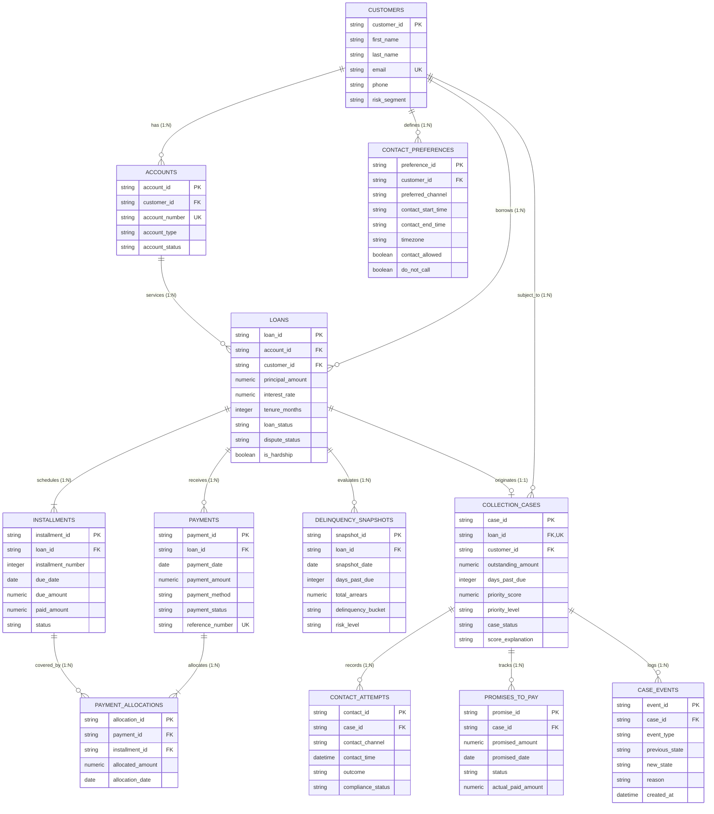

# Database Schema & Entity Relationships

This document outlines the relational architecture, cardinalities, cascade constraints, and indices for the YottaFlex Delinquency & Collections Management System.

---

## 1. Entity-Relationship Diagram

---

## 2. Cardinalities & Relationship Mechanics

| Parent Entity | Child Entity | Cardinality | Join Keys | Delete / Update Action |
| :--- | :--- | :--- | :--- | :--- |
| `Customer` | `Account` | $1 : N$ | `customer_id` | `ON DELETE CASCADE` |
| `Customer` | `ContactPreference` | $1 : N$ | `customer_id` | `ON DELETE CASCADE` |
| `Customer` | `Loan` | $1 : N$ | `customer_id` | `ON DELETE RESTRICT` |
| `Account` | `Loan` | $1 : N$ | `account_id` | `ON DELETE RESTRICT` |
| `Loan` | `Installment` | $1 : N$ | `loan_id` | `ON DELETE CASCADE` |
| `Loan` | `Payment` | $1 : N$ | `loan_id` | `ON DELETE RESTRICT` |
| `Loan` | `DelinquencySnapshot` | $1 : N$ | `loan_id` | `ON DELETE CASCADE` |
| `Loan` | `CollectionCase` | $1 : 1$ | `loan_id` | `ON DELETE RESTRICT` (Unique) |
| `Payment` | `PaymentAllocation` | $1 : N$ | `payment_id` | `ON DELETE CASCADE` |
| `Installment` | `PaymentAllocation` | $1 : N$ | `installment_id` | `ON DELETE RESTRICT` |
| `CollectionCase` | `ContactAttempt` | $1 : N$ | `case_id` | `ON DELETE CASCADE` |
| `CollectionCase` | `PromiseToPay` | $1 : N$ | `case_id` | `ON DELETE CASCADE` |
| `CollectionCase` | `CaseEvent` | $1 : N$ | `case_id` | `ON DELETE CASCADE` |

---

## 3. Database Indices for Performance Optimization

1. **`customers`**: `email` (Unique), `phone`
2. **`accounts`**: `customer_id`, `account_number` (Unique)
3. **`loans`**: `customer_id`, `account_id`, `loan_status`
4. **`installments`**: `loan_id`, `due_date`, `status`, Composite `(loan_id, installment_number)` (Unique)
5. **`payments`**: `loan_id`, `payment_date`, `reference_number` (Unique)
6. **`payment_allocations`**: `payment_id`, `installment_id`, Composite `(payment_id, installment_id)`
7. **`delinquency_snapshots`**: `loan_id`, `snapshot_date`, Composite `(loan_id, snapshot_date)`
8. **`contact_preferences`**: `customer_id`
9. **`collection_cases`**: `loan_id` (Unique), `customer_id`, `priority_score`, `case_status`
10. **`contact_attempts`**: `case_id`, `contact_time`, `compliance_status`
11. **`promises_to_pay`**: `case_id`, `promised_date`, `status`
12. **`case_events`**: `case_id`, `created_at`, `event_type`
